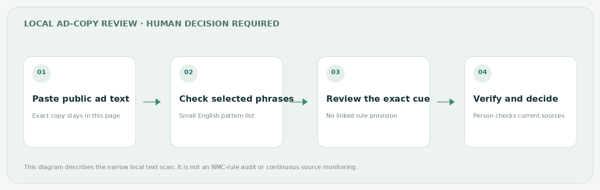

# NextComply AI


## A focused review workspace for healthcare advertising

This local project is organized around one practical question: what wording in a public-facing healthcare advertisement should a person pause to review before publication? The primary screen accepts ad copy, highlights a small number of language patterns, explains why the wording may need context, and offers a neutral drafting aid. It keeps the source-check action, document utilities, and internal sample workflows available as supporting areas.

The product direction is inspired by healthcare advertising review for Indian clinics and healthcare brands. The implementation is intentionally narrower than that ambition: its local text scan is a small English phrase-pattern demonstration, not an NMC rule engine, a medical assessment, or legal advice. A qualified reviewer must verify the exact content, evidence, current official material, jurisdiction, and applicability.

> Use fictional content only. Do not enter patient-identifiable information, confidential hospital data, credentials, or real patient stories. This local learning project is not a hospital deployment and never declares an advertisement compliant or non-compliant.

## 1. Start the project

The ZIP contains a browser interface made with HTML, CSS, and JavaScript, a FastAPI service, and a local SQLite database. It does not use Streamlit; Streamlit is not required. The Windows run steps below are also in the project README.

1. Unzip the package.
2. In VS Code, choose **File → Open Folder** and open the nested `nextcomply-ai` folder. It must directly contain `app\\main.py`, `requirements.txt`, and `pyproject.toml`.
3. Open a PowerShell terminal in that folder. Replace the example extraction path:

```powershell
Set-Location "C:\\path\\to\\NextComply-AI-Local-Demo\\nextcomply-ai"
Test-Path .\\app\\main.py   # Must print True
py -3.11 -m venv .venv
.\\.venv\\Scripts\\Activate.ps1
python -m pip install --upgrade pip
python -m pip install -r requirements.txt
if (-not (Test-Path .env)) { Copy-Item .env.example .env }
python -m uvicorn app.main:app --reload
```

Open `http://127.0.0.1:8000`. API documentation is at `http://127.0.0.1:8000/docs`. Stop the server with Ctrl+C in its terminal. Run tests from the same project root with `python -m pytest -q`.

### If Python says `ModuleNotFoundError: No module named 'app'`

That error usually means Uvicorn started from a different folder. Check `Get-Location` and `Test-Path .\\app\\main.py`. If the second command returns `False`, change into the extracted `nextcomply-ai` project root and confirm it returns `True` before starting Uvicorn. Do not start it from another project directory. This is the correct working-directory check, not a claim that an earlier local error has been fixed on your computer.

## 2. The primary screen: review healthcare ad copy

The Overview screen opens with an editorial advertising-review workspace, a clear “Start an ad review” action, and a complementary manual source-check route. Its layered hero cards are visibly labeled as illustrative examples, not live scan outcomes. The local pattern scan and actual source-check behavior are explained separately below.

### Ad copy, available in this build

Paste up to 2,000 characters of public-facing copy, or select **Load illustrative sample**. The sample is fictional and exists only to show how the local pattern scan responds. Press **Review ad copy** to see the local result.

The browser checks a small, explicit set of English-language patterns, such as ranking/superiority wording, absolute promises, and certain-outcome terms. It displays matched phrases verbatim, a plain-language explanation of why a reviewer may want context, and a general reviewer suggestion. A no-match result says only that this short pattern list found no cue. It does not mean the advertisement is safe, accurate, authorized, or compliant.

The interface shows an evidence panel for each run: the exact matched text, the method, and whether a specific official provision was linked. In this local text scan, no official provision is linked. This is deliberate transparency: the separate source page does not automatically map a fetched notice to ad-copy phrases.

When cues are found, the page displays a generic neutral wording example separately from the original copy: “Treatment options vary by individual. Consult a qualified clinician to discuss suitability, expected outcomes, and risks.” It is not tailored to the original copy, a compliant rewrite, medical advice, a factual claim about the organization, or pre-approved copy. A human must edit it against evidence and the actual service.

The result is kept in the current page only. It is not written to the persistent review register or included in the PDF report. The sample ad copy is also not submitted to a model or external service by this new local browser-side scan.

### Poster, PDF, video, and website content

The intake cards distinguish what this build can and cannot do:

- **Poster/PDF:** the separate document page can extract text from PDF, DOCX, or TXT files. It does not inspect the visual design, run OCR on scans, or check an image. A PDF containing selectable text may be processed by the document extraction route, but that does not make it an image-ad audit.
- **Video/website:** not analyzed by this build. There is no video transcription, frame analysis, website crawler, or ad-page assessment.

These are visible scope labels, not working upload modes on the primary ad-copy screen.

## 3. Exact implementation flow



1. **Enter exact copy.** The local browser UI reads the text in the ad-copy field.
2. **Scan simple patterns.** A small deterministic JavaScript pattern list looks for selected phrases. It does not interpret surrounding meaning or check an official rule database.
3. **Show the evidence.** The interface quotes the phrase and states the local method. It explicitly reports that no official provision is linked.
4. **Offer a general drafting aid.** If a cue is found, the page displays the same generic clinician-suitability sentence as a separate example. It does not edit, replace, or validate the original ad copy.
5. **Leave the decision with a person.** The reviewer must inspect the full original, confirm factual support, check current official guidance, and decide whether to revise or publish.

This scan is not connected to the FastAPI document-analysis endpoint, the topic library, the local findings database, the on-demand source-check history, a language model, or a regulator source corpus. No compliance score is calculated.

> A highlighted phrase means only that a local pattern matched. It does not establish a violation. No highlighted phrase means only that the limited pattern list found no match. It does not establish compliance.

## 4. Editable company workspace and concept image

The company-name field in the sidebar starts blank. No hospital or business name is assumed. If this browser contains the old “Demo Hospital” placeholder, it is cleared. A name you type is saved in that browser's local storage and is not stored in the application database or synced to other browsers. When you download the PDF, the current name is sent as a report-generation query parameter and printed as its organisation name; if blank, the report says **Not specified**.

The hero image is generated conceptual artwork of a fictional Indian clinician recording a patient-education style video in a clinic studio. It is not a real clinician, clinic, ad, government or NMC seal, or proof of any regulatory requirement. The layered cards show only interface concepts and are marked “Example phrase” and “Not a live result.”

## 5. Other navigation areas

The refined navigation is grouped as a focused review desk: **Ad review**, **Documents & evidence**, **Operations**, **Reference library**, **Public source checks**, and **Build notes**. The first screen leads with healthcare-ad review; operational examples are secondary rather than the product identity.

The primary ad-copy review is the home experience. The sidebar retains supporting capabilities:

- **Ad & document review:** document extraction, phrase-based document observations, an evidence-limited question response, and the persistent finding register. The original database records remain illustrative; phrase checks are not legal findings.
- **Internal operations:** fictional alert history, acknowledgement and training examples, local audit records, and sample SOP excerpts. These are supporting workflow examples, not real hospital administration tools.
- **Knowledge library:** eight subject labels and guide-reported inventory figures. It contains no verified official regulatory text, active corpus, or citations. A figure in the guide is not a live database count. The source guide's count of nine authorities versus a table listing eight should not be repeated as complete coverage without reconciliation.
- **Regulatory source checks:** an explicit one-time fetch of selected public notice pages when a person presses the button. More detail follows below.
- **Architecture & readiness:** separates local code that runs from items described in the original architecture plan but not implemented here.

The local demo role flow, record changes, and audit log are not production authentication, security controls, or connections to any hospital.

## 6. Public regulator-source check: one-time, on demand

The **Regulatory source checks** page fetches a fixed list of public pages only after the user presses **Check sources now**, while the local FastAPI server is running. It makes ordinary HTTP requests with a 12-second timeout, follows redirects, and requests up to four sources concurrently. A lightweight parser looks for dated table rows and notice-like links, then may show extracted titles, dates, short snippets, and links. It keeps up to 12 rows per source for a run and stores completed results in the local SQLite database.

The configured list includes CDSCO, IRDAI, RBI, NMC, MoHFW/PCPNDT, MeitY/DPDP, CERT-In, and NABH. NABH is an accreditation and standards body, not a government regulator. A page request that fails is marked failed. A page that loads but yields no reliable rows keeps a checked status with a message that no reliable rows were extracted. Neither state is described as “no updates.”

This is **not continuous monitoring**. There is no schedule, background task, notification, email, hosted job, or check while the local server is stopped. Page formats may change, use client-side rendering or PDFs, or block requests. The parser can miss or misread a notice. A successful fetch is not proof of a complete or current review. Open the source page and verify the actual notice, issue date, authority, scope, current status, and applicability yourself with a qualified reviewer.

The latest source results appear on the source-check page. Each run is stored in local SQLite, but this build does not expose a history-browsing screen. Results are not automatically attached to an ad-copy cue, added to findings, or included in the PDF review report. The text-pattern scan does not consult these sources. This local feature is separate from Wabi's chat research action.

## 7. Supporting document workflow and report

The **Ad & document review** page accepts PDF, DOCX, and TXT files up to the configured upload limit. The API extracts readable text and stores the file under the local `data` directory. It does not perform OCR on scanned pages, analyze images, or process video. Use only fictional, non-sensitive sample content.

A selected topic and small phrase list can produce a low-priority document observation. The output says what was or was not matched and leaves the reviewer responsible for interpretation. The question workflow can report lexical overlap against uploaded extracted text, but no verified regulatory content or connected language model is available; it cannot substantiate regulatory answers.

The downloadable PDF is a local snapshot of stored document metadata, observations, reviewer status, source labels, and suggested actions. It does not include the separate source-check results or create a regulator-cited assessment. The editable company name is included only when supplied.

## 8. Stack and architecture boundaries

The current local ZIP is a functional prototype rather than the recommended target implementation. Its interface is plain HTML, CSS and JavaScript served by FastAPI; persistence uses SQLite. The current project does not implement React, TypeScript, Vite, Tailwind, Framer Motion, PostgreSQL, pgvector, or LlamaIndex. The visual motion in this prototype is small CSS entrance animation and smooth in-page scrolling, not Framer Motion.

The recommended next build stack is React + TypeScript + Vite, Tailwind + Framer Motion, FastAPI, PostgreSQL + pgvector, and PyMuPDF. Add LlamaIndex after verified, versioned regulatory materials and a retrieval evaluation set are ready. This recommendation is a future direction; it does not describe dependencies or behavior already in the ZIP.

## 9. Architecture and boundaries

| Area | Implemented in this local project | Not connected or implemented |
|---|---|---|
| Main ad-copy scan | Browser-side selected English phrase patterns and quoted matches | NMC rule engine, multilingual analysis, full semantic review, compliance score |
| Suggestions | Generic neutral wording example shown separately from the original | Verified, legally compliant or clinically reviewed replacement copy |
| Public-source page | Manual fetch of fixed URLs, lightweight HTML row parser, per-site status, with only the latest run shown | Continuous monitoring, scheduling, exhaustive crawl, alerts, reliable coverage guarantee |
| API and database | FastAPI on localhost and local SQLite | Hosted service, PostgreSQL/pgvector, tenant isolation |
| Document text | PDF/DOCX/TXT extraction | OCR, image review, video transcription, website scanning |
| Retrieval and AI | Explicit phrase/lexical checks | Embeddings, RAG, LlamaIndex, LLM, LangGraph agents |
| Identity | Local demonstration role flow | Hospital SSO, production access control, security certification |
| Reporting | Downloadable local PDF snapshot | Regulatory legal opinion or certified compliance result |

Descriptions of a planned architecture are not evidence that those components are implemented. Do not describe this build as ready for hospital use.

## 10. Demonstration sequence

1. Start on **Compliance workspace** and point out the blank, editable company name.
2. Load the fictional sample, then run the ad-copy review. Show the exact matched phrase, explanation, evidence panel, and neutral drafting aid.
3. Explain that this uses only a small local English pattern list, not NMC rules or an AI model. Show that the result is not stored in findings or the PDF.
4. Open **Regulatory source checks**. Run a one-time fetch and distinguish fetched pages with rows, fetched pages without reliable rows, and failed requests. Open the original site for a human to verify.
5. Visit the document and internal pages only as supporting local examples. Highlight the limits and fictional records rather than presenting a general hospital dashboard as the product's main purpose.

## 11. Reset and data handling

The SQLite database and uploaded files are under `./data/`. Stop the server before removing that folder to reset the local demo. The company name is in browser local storage. Local files are not encrypted and the application has no clinical-data safeguards. Do not use patient data, confidential healthcare records, or real operational decisions.
